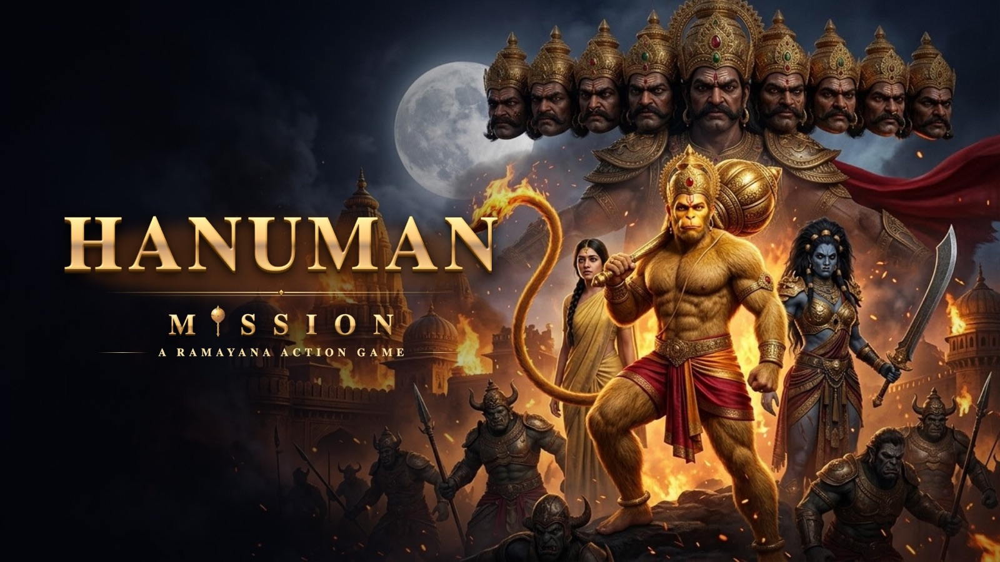
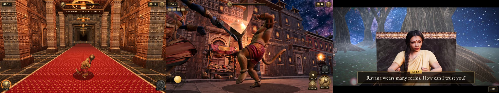
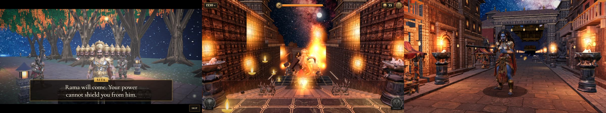
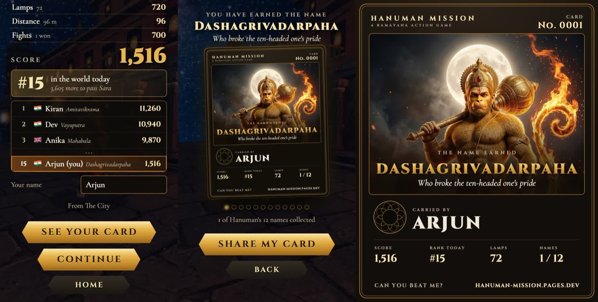
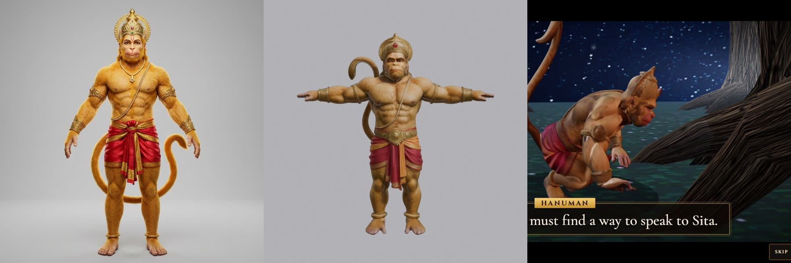
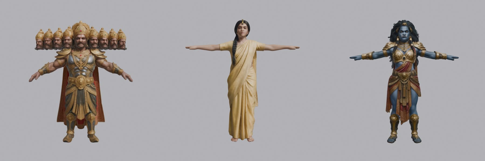

<p align="center"></p>

# Hanuman Mission

A 3D Ramayana action game that plays in the browser, on a phone or a computer. Every character in it was made with
Aholo Lux3D.

**Play it free: https://hanumanmission.com**



You are Hanuman on his night in Lanka. Run the streets of the golden city, fight Lankini at the gate and the palace
guards, find Sita in the Ashoka grove and give her Rama's ring, stand bound before Ravana, and when they set your tail
alight, burn Lanka.

Made by Sidharth N for the Manycore Aholo Global 3D AI Hackathon (`#Manycorehackathon`).

## The story

The Ramayana is India's first epic poem, composed in Sanskrit by the sage Valmiki more than two thousand years ago
and still told across Asia today. Hanuman Mission plays its fifth book, the Sundara Kanda: Ravana, the ten-headed
king of Lanka, has carried off Sita, the wife of Prince Rama, and Hanuman leaps the ocean alone to find her.



## What is in the game

- **The story first.** A one-minute film tells how the mission began. It is offered on a first visit (with sound or
  without) and can be skipped; the title can show it again.
- **A run through nine places:** the sea gate, the city, the bridges, the stairway, the palace court, the inner
  palace, the grove, the throne hall and the burning streets. Lanes to change, gaps to leap, beams to slide under,
  lamps to gather, wind to gather for a flight, and the mace's strength when its meter is full.
- **Three fights** with their own controls: Lankini, the palace guards, the guards of the grove.
- **Scenes played in the game's own world**, with voices and subtitles: Lankini's challenge, Ravana and Sita in the
  grove, the ring and the hair jewel, the capture, Ravana's court, the tail set alight.
- **A leaderboard** for today and for all time, a score worked out by the server, and a **card** to share. Every
  finished run earns one of the **twelve names of Hanuman**, each with its own picture.
- **Installable**: it can be added to a phone's home screen and keeps its models once downloaded.



## Controls

| | Phone | Keyboard |
|---|---|---|
| Change lane | swipe left or right | `←` `→` or `A` `D` |
| Leap | swipe up | `↑`, `W` or `Space` |
| Slide | swipe down | `↓` or `S` |
| Fly (when the wind is gathered) | Fly button | `F` |
| Smash (when the meter is full) | Smash button | `G` |
| In a fight | stick, Strike, Jump, Dodge, Smash | `W` `A` `S` `D`, `J` or click, `Space`, `Shift`, `G` |
| Pause | pause button | `Esc` |

## How Aholo Lux3D was used

Every character and every prop of the world began as one picture and was turned into a 3D model with Aholo Lux3D
(G1 and G1-Turbo) through the Aholo API, from scripts in `tools/`: 33 models in all.





- **The cast:** Hanuman, Lankini, Ravana, Sita and the palace guard. Lux3D made the models; its auto-rig and animation
  tools gave Lankini, Ravana and Sita their skeletons and movement, while Hanuman and the guard move with Mixamo
  carried onto their Lux3D models. Both were also rigged with Lux3D's auto-rig and given 20 movements each by its
  animation retarget through the API, for a later swap. The cast was then finished in Blender (hands, faces, weights, texture size) with
  the scripts in `tools/`.
- **The world kit:** the Lanka gate, palace, street arch, market stall, cart, brazier, barricade, pots, the Ashoka
  trees, the rakshasa statue, the Shiva and Nandi of Ravana's court, the mace and Sita's hair jewel.
- **Also tried along the way:** SpatialGen for a night panorama, part split for a Nandi in moving parts, and the Aholo
  image tool for pictures of the statues.
- The pictures, the raw results and each step of an asset are kept under `assets/` (`concepts*`, `lux3d`, `library`).

## Built with

| Tool | Used for |
|---|---|
| Aholo Lux3D (G1 and Turbo, auto-rig, animation) | characters, statues and props; skeletons and movement for Sita, Ravana and Lankini |
| Aholo API, SpatialGen, part split, image tool | picture to model by script; a panorama, a split statue and statue pictures tried on the way |
| Google Flow image models | concept pictures, from original designs |
| Three.js, Vite | the game |
| Blender | finishing the cast |
| Mixamo | Hanuman's and the guards' movement |
| ElevenLabs | voices |
| Freesound and other free libraries | sound effects and parts of the score (see the credits files) |
| Cloudflare Pages, Pages Functions, D1 | hosting, the scores service, the leaderboard |

## Run it

```
cd game
npm install
npm run dev        # http://localhost:5173
npm run build      # the site, in game/dist
```

The game plays without a server. The leaderboard and the film's streaming need the small service in
`game/functions/` on Cloudflare Pages: a D1 database made from `game/functions/schema.sql` and bound as `DB`
(`game/wrangler.toml`), and a secret named `SCORE_KEY`. Without them a run still plays and its score is shown; it is
simply not ranked.

## Where things are

| Path | What |
|---|---|
| `game/src/` | the game: `main.js` (loop, screens), `world.js` and `places.js` (the route), `hero.js`, `fight.js`, `story.js` and `story.json` (scenes and lines), `sound.js`, `scores.js`, `card.js` |
| `game/functions/` | the scores service and its tables |
| `game/public/` | models, pictures, sound, the story film, icons |
| `tools/` | scripts that make and finish the 3D assets |
| `assets/` | concept pictures, Lux3D results, brand art, sound sources and their credits |

## Credits

Sound and music credits are listed in `game/public/assets/sfx/CREDITS.txt`, `game/public/assets/audio/score/CREDITS.txt`
and `assets/sound/*/credits.txt`. The song and the chant heard during the run on the public site are not part of this
repository.

The Ramayana is an ancient epic. The character designs, the models and the game are original work.
